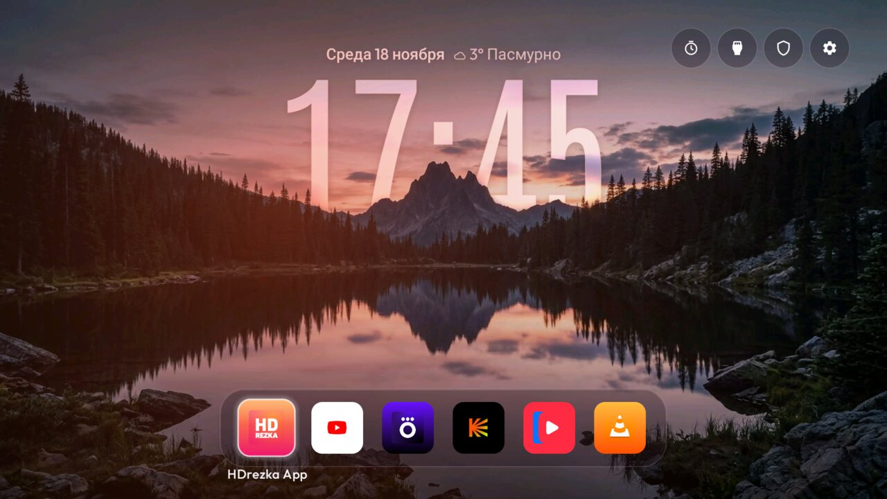
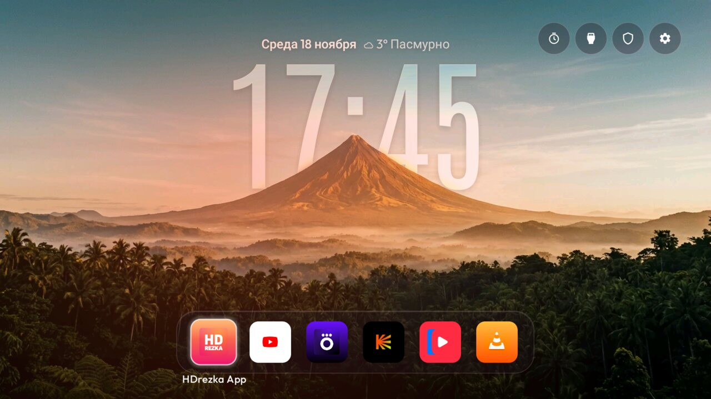
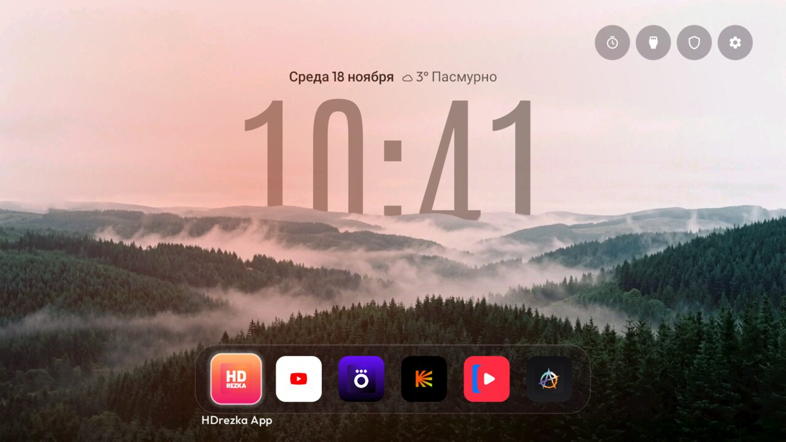
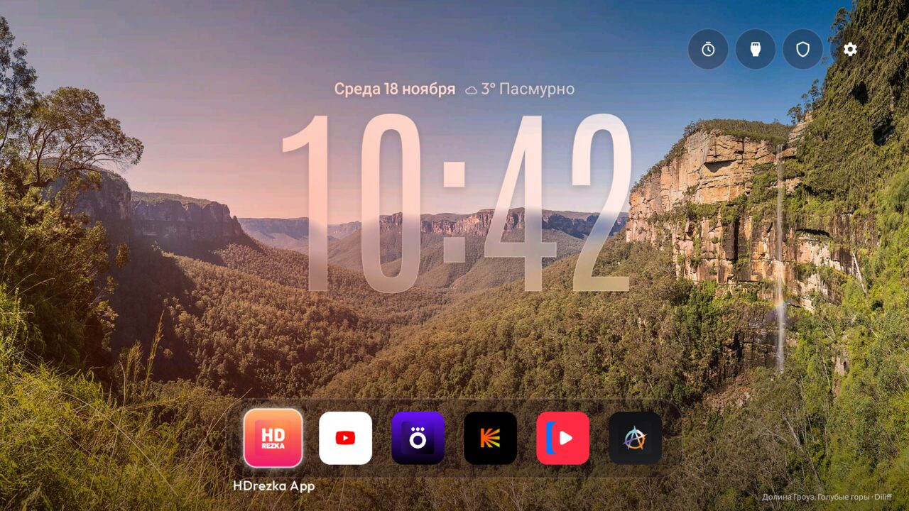
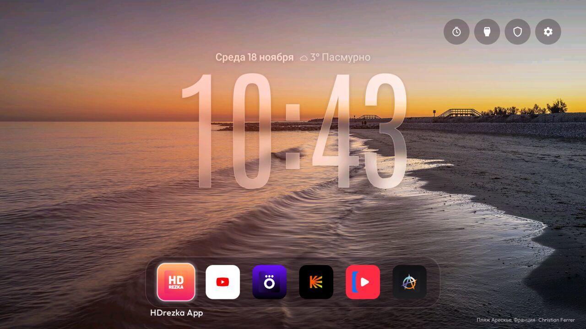
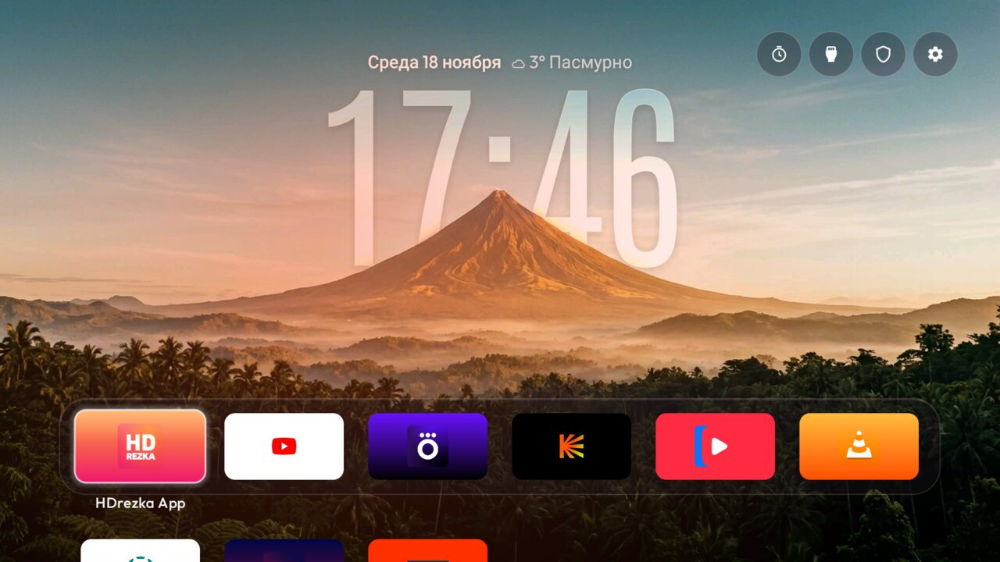
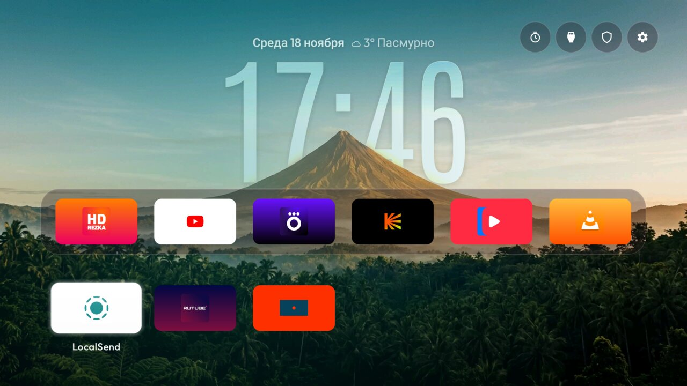
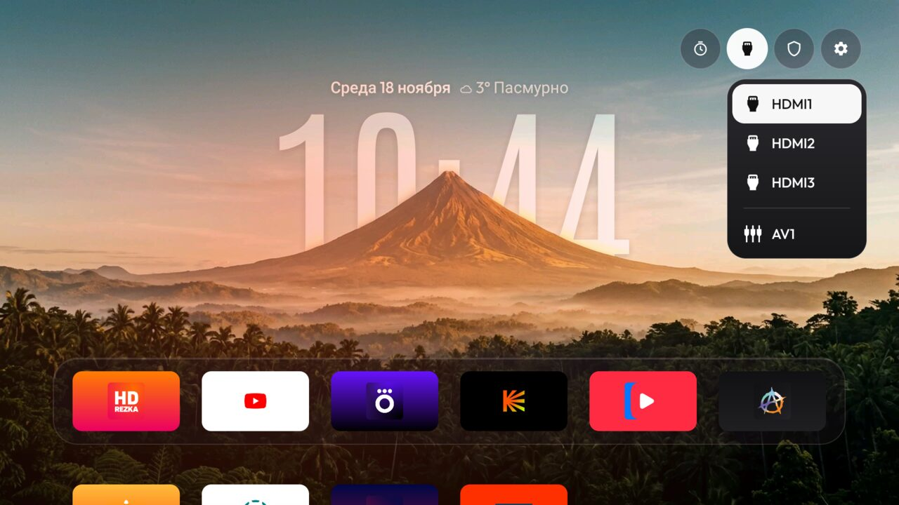
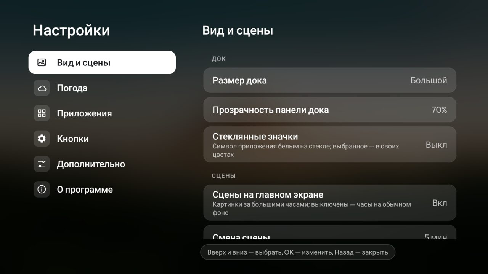
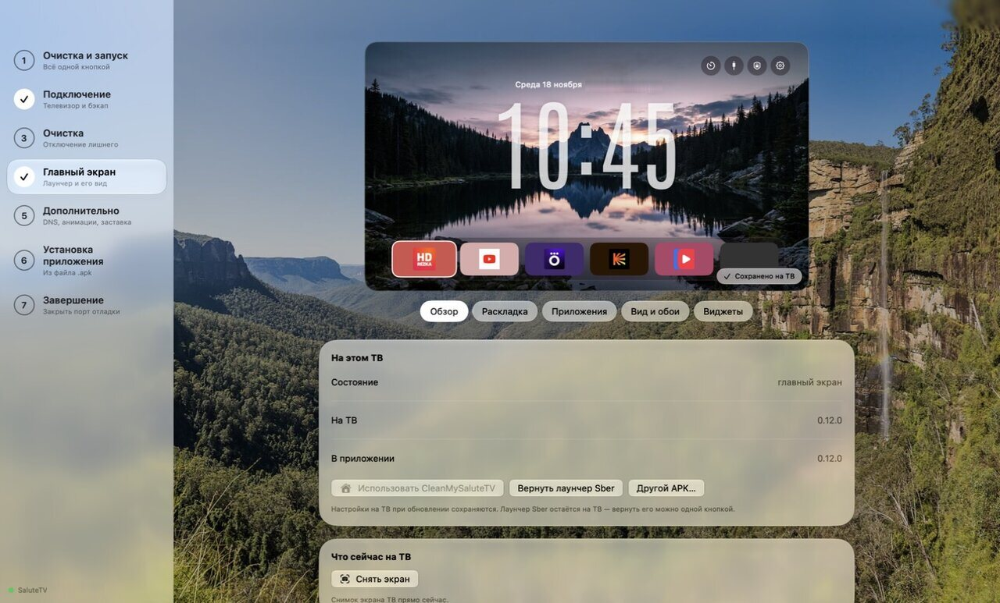

<p align="center"></p>

<h1 align="center">CleanMySaluteTV</h1>

<p align="center">
  <b>Салют ТВ без рекламы и лишнего — с Mac по Wi-Fi.</b><br>
  Свой главный экран со сценами и стеклянными часами, только ваши приложения, предустановки Sber отключены.
  Без root, ничего не удаляется, всё возвращается одной кнопкой.
</p>

<p align="center">
  
  
  
  <a href="LICENSE"></a>
</p>

<p align="center"><b>
  <a href="#с-чего-начать">С чего начать</a>
  &nbsp;·&nbsp; <a href="#что-получится">Что получится</a>
  &nbsp;·&nbsp; <a href="#приложение-для-mac">Приложение для Mac</a>
  &nbsp;·&nbsp; <a href="#безопасность">Безопасность</a>
  &nbsp;·&nbsp; <a href="#вопросы">Вопросы</a>
</b></p>

## Зачем

Телевизор Sber — хороший экран, но главный экран у него рекламный:

- ряды «рекомендаций», промо Okko, СберПрайм и умного дома вместо ваших приложений;
- десятки предустановок, которые висят в памяти, а её у ТВ всего 2 ГБ оперативной и 3 ГБ для приложений;
- заставка Sber скачивает видео и держит около 200 МБ на диске;
- телеметрия, опросы и сервисы, которые вы не просили.

CleanMySaluteTV отключает лишнее по проверенному списку для Sber и ставит лёгкий главный экран (около 5 МБ).

## С чего начать

| Как | Что нужно | Подходит, если |
|---|---|---|
| **Приложение для Mac** (рекомендую) | Mac на macOS 26 в той же сети Wi-Fi | Хочется кнопками: подключиться, почистить, настроить вид и сразу видеть результат. [Подробнее](#приложение-для-mac) |
| **ИИ-ассистент** | Claude Code, Codex или похожий, папка этого репозитория | Хочется, чтобы всё сделали за вас и спросили только нужное: он читает [AGENTS.md](AGENTS.md) |
| **Вручную** | `adb`, JDK 17, Android SDK 34, Python 3 | Любите терминал. [Команды](#вручную) |

В любом случае сначала включите на ТВ отладку (ADB). Основной способ — с телефона через
[Сбер Studio](https://developers.sber.ru/studio/): «Настройки → Настройки сервисов → SmartApp →
Мои устройства», добавить ТВ по серийному номеру и включить «Функция ADB», потом перезагрузить ТВ.
Пошагово, и запасной способ через «Для разработчиков»: [docs/SBER.md](docs/SBER.md#включить-adb).
При первом подключении ТВ может спросить «Разрешить отладку?» — отметьте «Всегда» и нажмите OK.
После установки выключите ADB там же, где включали.

## Как это работает

| Шаг | Что происходит |
|---|---|
| **Бэкап** | Сохраняется, что было: лаунчер, заставка, DNS, список приложений. |
| **Отключение** | Реклама, телеметрия и лишние предустановки Sber отключаются через `pm disable-user`. Ничего не удаляется. |
| **Главный экран** | Ставится CleanMySaluteTV и становится главным: кнопка Home открывает его. |

**Без root, без проводов, ничего не удаляется, откат одной кнопкой.**

## Что получится

<p align="center"></p>

| | |
|---|---|
|  |  |
| *Часы за фото: горы, деревья и туман закрывают цифры* | *Дата и погода над часами, город — какой выберете* |
|  |  |
| *Часы поверх фото: пять фотографий с Wikimedia, автор внизу* | *Сцены сменяются сами, раз в 10 секунд — 5 минут* |
|  |  |
| *Большие плитки: до 6 приложений в доке* | *«Вниз» — остальные приложения* |
|  |  |
| *Входы: все HDMI и AV, даже те, что прячет StarOS* | *Настройки прямо на ТВ: шестерёнка справа вверху* |

**Ещё:**

- **Десять сцен** в двух группах: где часы прячутся за фото и где стоят поверх. Какие показывать — на выбор.
  В сценах «за фото» у часов своё место, как в couch-tv; на фото их можно поставить слева, по центру или справа.
- **Док** из маленьких иконок (4–9) или больших плиток (4–6), стеклянная панель в цветах couch-tv,
  прозрачность от сплошной до одной рамки.
- **Верхние кнопки** — какие и в каком порядке: таймер сна, входы, VPN (открывает выбранное приложение),
  память, Bluetooth, звук, изображение, заставка, выключение экрана, все приложения, настройки ТВ.
- **Приложения**: в доке, «ещё» под доком или скрыты — в меню на ТВ или перетаскиванием в приложении для Mac.
- **Стеклянные значки**: символ приложения белым на стекле, как в tvOS.
- **Погода** из Open-Meteo, город ищется прямо в меню.
- **AirPlay**: если стоит AirPlay Server, лаунчер держит ТВ видимым для iPhone и Mac ([docs/AIRPLAY.md](docs/AIRPLAY.md)).

## Приложение для Mac

<p align="center"></p>

Семь шагов слева, как в [CleanMyTV](https://github.com/wingedpanther/cleanmytv):

1. **Очистка и запуск** — всё одной кнопкой: бэкап, отключение лишнего, установка лаунчера.
2. **Подключение** — найдёт ТВ в сети, покажет модель и свободную память, снимет экран.
3. **Очистка** — приложения Sber с советом и переключателем «Работает / Отключено».
4. **Главный экран** — живое превью ТВ и вкладки «Раскладка», «Приложения», «Вид и обои», «Виджеты».
   Изменения уходят на ТВ сами. Своё фото с Mac — фоном ТВ.
5. **Дополнительно** — блокировка рекламы через DNS, скорость анимаций, заставка.
6. **Установка приложения** — перетащите `.apk` в окно.
7. **Завершение** — проверка перезагрузкой и что порт отладки закрыт.

Собрать и открыть (adb и APK лаунчера окажутся внутри приложения):

```bash
bash mac/build.sh --open
```

Как оно устроено: [docs/MAC.md](docs/MAC.md).

## Безопасность

- **Только отключение.** `pm disable-user`, никаких удалений. Всё отключённое записывается, и «Вернуть
  всё как было» включает его обратно.
- **Бэкап до изменений**: лаунчер, заставка, DNS и списки приложений.
- **Не трогает нужное**: платформа Sber, ассистент, входы HDMI, клавиатура, WebView, заводские меню CVTE
  перечислены в [`profiles/never.txt`](profiles/never.txt) и не отключаются, даже если окажутся в списке.
- **Лаунчер Sber остаётся на ТВ**: вернуть его можно одной кнопкой.
- **Ничего не отправляет наружу.** Настройки ходят только между вашим Mac и ТВ. В сеть уходят лишь запросы
  погоды и поиска города в Open-Meteo.
- **После работы выключите отладку** — шаг «Завершение» напомнит и проверит, что порт закрыт.

## Вернуть как было

- В приложении для Mac: **Подключение → Вернуть всё как было**.
- Вручную: `bash scripts/restore.sh` (с `--uninstall` ещё и удалит лаунчер).
- Только главный экран: **Главный экран → Обзор → Вернуть лаунчер Sber**.

## Проверено на

| Телевизор | Система | Что проверено |
|---|---|---|
| Sber SDX-55UQ5231 | StarOS, Android 13 | Очистка, лаунчер, сцены, док, кнопки, входы HDMI 1–3 и AV, настройка с Mac |
| Sber Салют ТВ pb766, at30a6 | StarOS, Android 11 и 13 | Списки отключения — из [cleanyourtv](https://github.com/Gathin23/cleanyourtv) |

## Вопросы

**Это не сломает телевизор? Гарантия?**
Отладка — штатная функция Android, root не нужен, система не меняется. Всё отключённое включается обратно.

**Кнопка Home спрашивает, какой лаунчер открыть.**
Так бывает, когда на ТВ ставят ещё один лаунчер: Android сбрасывает выбор. Выберите CleanMySaluteTV →
«Всегда», или в приложении для Mac: **Главный экран → Обзор → Использовать CleanMySaluteTV**.

**После перезагрузки вернулись Okko, СберПрайм и другие.**
Сервис Sber включает часть приложений обратно после перезагрузки. Лаунчер прячет их с главного экрана,
а отключить снова можно на шаге «Очистка». Подробнее: [docs/SBER.md](docs/SBER.md#что-делает-sber-после-перезагрузки).

**После обновления прошивки реклама вернулась.**
Подключитесь снова и пройдите «Очистка и запуск»: отключится то, что вернулось, а лаунчер останется главным.

**Онлайн-кинотеатр перестал показывать видео.**
Сначала выключите блокировку рекламы через DNS (шаг «Дополнительно»): некоторым приложениям нужны домены,
которые она режет. Не помогло — «Вернуть всё как было» и перезагрузите ТВ.

**Не подключается.**
ТВ и Mac должны быть в одной сети, отладка включена, окно «Разрешить отладку?» подтверждено. Если ТВ не
отвечал долго, перезапустите adb: `adb kill-server` — и подключитесь снова.

## Вручную

```bash
brew install openjdk@17
brew install --cask android-commandlinetools android-platform-tools
JAVA_HOME=/opt/homebrew/opt/openjdk@17 sdkmanager --sdk_root=/opt/homebrew/share/android-commandlinetools "platforms;android-34" "build-tools;34.0.0"
```

```bash
cp cleanmysalutetv.conf.example cleanmysalutetv.conf   # впиши TV_IP, док, приветствие
bash scripts/preflight.sh                              # одна сеть? отладка включена? разрешена?
bash scripts/connect.sh                                # на ТВ: «Разрешить отладку?» → Всегда → OK
bash scripts/backup.sh                                 # всегда первым
bash scripts/inspect.sh                                # что на ТВ: disable / ask / keep / never
bash scripts/debloat.sh debloat-list.txt               # отключить выбранное, пачками со скриншотами
bash scripts/install.sh                                # собрать, поставить, применить настройки, сделать Home
```

Поменять настройки: правите `cleanmysalutetv.conf` → `bash scripts/install.sh --config-only`.
Только собрать APK: `bash scripts/build.sh` (с `--test` — ещё и тесты).

## Документация

| Установка | Использование | Устройство |
|---|---|---|
| [Салют ТВ: ADB, что возвращает Sber](docs/SBER.md) | [Приложение для Mac](docs/MAC.md) | [Все настройки config.json](docs/CONFIG.md) |
| [Для ИИ-ассистента](AGENTS.md) | [AirPlay](docs/AIRPLAY.md) | [Что дальше](docs/ROADMAP.md) |

## Спасибо

| Проект | Что взято |
|---|---|
| [Gathin23/cleanyourtv](https://github.com/Gathin23/cleanyourtv) | Основа лаунчера и списки для Sber |
| [Seagey/couch-tv](https://github.com/Seagey/couch-tv) | Сцены со стеклянными часами, вид дока и кнопок, стеклянные значки, сцены-картинки |
| [wingedpanther/cleanmytv](https://github.com/wingedpanther/cleanmytv) | Шаги приложения для Mac и вкладка «Главный экран» с превью |
| [sridathballeda/cleantv](https://github.com/sridathballeda/cleantv) | Скрипты установки: бэкап, классификация пакетов, откат |
| [techgenius1/tvOS-Launcher](https://github.com/techgenius1/tvOS-Launcher) | Образец раскладки меню |
| [petrobot-admin/hume-launcher](https://github.com/petrobot-admin/hume-launcher) | Слежение за AirPlay (Apache 2.0) |

Фото сцен «поверх фото» — Wikimedia Commons (CC BY-SA), авторы подписаны на экране и в [NOTICE](NOTICE).
Погода — [Open-Meteo](https://open-meteo.com), запасной источник — MET Norway.

## Лицензии

Код — MIT ([LICENSE](LICENSE)), включая части из проектов выше: их уведомления в [NOTICE](NOTICE), полные
лицензии в [licenses/](licenses/). Шрифты Outfit и Antonio — SIL OFL 1.1. adb внутри приложения для Mac —
Apache 2.0.
