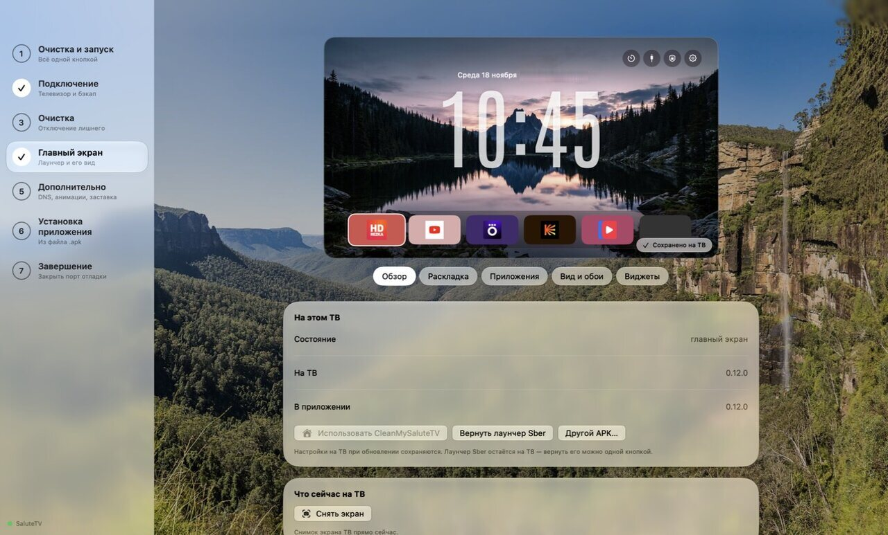

# Приложение для Mac

`mac/` — приложение на SwiftUI в стиле Liquid Glass (macOS 26+). Внутри уже есть adb, профиль очистки
Sber и APK лаунчера: на Mac больше ничего ставить не нужно.

```bash
bash mac/build.sh --open      # собрать mac/build/CleanMySaluteTV.app и открыть
swift run --package-path mac  # для разработки: adb и APK ищутся в репозитории
```



## Шаги

1. **Очистка и запуск** — одной кнопкой: бэкап, отключение рекомендуемого из `profiles/*.tsv` (Sber, Xiaomi, Mi Box, Android TV),
   установка лаунчера, он же главный экран. Потом открывается шаг 4.
2. **Подключение** — как включить ADB через Сбер Studio (шаги и QR-код для телефона), поиск ТВ в сети
   (порт 5555 по всей /24 вокруг Mac), сведения, снимок экрана, бэкап и «Вернуть всё как было».
3. **Очистка** — приложения Sber по группам «Советую отключить / По желанию / Лучше оставить» с
   переключателями — только то, что стоит на ТВ; пакеты из `profiles/never.txt` не отключаются никогда,
   а всё остальное перед отключением проверяет на ТВ `profiles/guard.sh`; очистка кэша приложений.
4. **Главный экран** — живое превью экрана ТВ и вкладки «Обзор», «Раскладка», «Приложения», «Вид и обои»,
   «Виджеты». Каждое изменение само уходит на ТВ через полсекунды, кнопки «Применить» нет.
5. **Дополнительно** — частный DNS против рекламы (AdGuard или свой), скорость анимаций, заставка.
6. **Установка приложения** — перетащить `.apk` в окно.
7. **Завершение** — проверка перезагрузкой, как выключить ADB (в Studio или в меню разработчика), проверка, что порт 5555 закрыт.

## Бэкап

Перед первым изменением приложение сохраняет, что было на ТВ: какой лаунчер открывала кнопка Home,
заставку, частный DNS, списки пакетов. Всё, что отключило само приложение, записывается в
`disabled_by_us.txt`. Лежит в `~/Library/Application Support/CleanMySaluteTV/<адрес ТВ>/`.
«Вернуть всё как было» включает отключённое (в обратном порядке), возвращает лаунчер Sber, заставку и DNS.

## Как настройки попадают на ТВ

Через `ThemeProvider` лаунчера (`RemoteSettings`). Доступно только оболочке adb: провайдер требует
`WRITE_SECURE_SETTINGS`, которое обычным приложениям не выдаётся.

```bash
U=content://com.rookmeister.cleanmysalutetv.theme
adb shell content call --uri $U --method export       # пишет remote/state.json и remote/icons/<пакет>.png
adb shell content read --uri $U/remote/state.json      # что сейчас на ТВ: настройки, сцены, места часов, кнопки, приложения
adb shell "content write --uri $U/remote/apply.json < /data/local/tmp/apply.json"
adb shell content call --uri $U --method apply         # применяет apply.json; главный экран перестраивается
```

`apply.json`: `{"choices": {…}, "apps": {"home": [...], "hidden": [...]}}`, любая часть необязательна.
Принимаются только известные ключи, каждый своего типа (`RemoteSettings.BOOLS / INTS / STRINGS`).
Свои обои — `wallpaper.jpg` через тот же провайдер; сцены при этом выключаются.

## Иконка

`mac/AppIcon.icon` — формат Icon Composer (градиент и стеклянный телевизор). `mac/build.sh` собирает его
`actool` в `Assets.car` (Liquid Glass для macOS 26) и `AppIcon.icns`.
